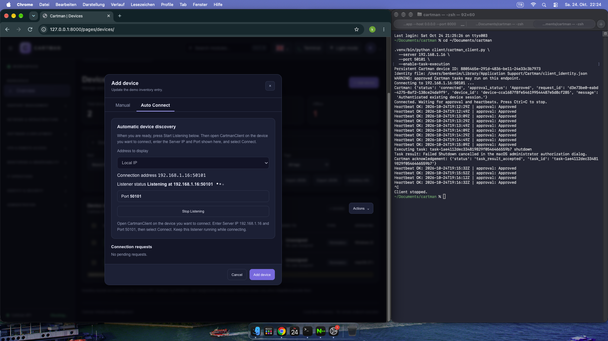

## Changes:

No issue was touched from 0.1a. (norwegian issue still exists.)

Overview went to live API's.

Now overview page is fully compatible with real API's.

Device page has connected to real API's.

Actions can take real actions, tested with a Mac and Windows Client.

Windows client .exe exists but not eally healthy. Not packed.

Everything except self test and shutdown is untested because there's no real API for it yet.

API and .js works fine in Devices, now device search exists in manual and automatic device finder.

Shutdown with a time limiter is possible from 1 seconds to 80k seconds.

In Devices, Device's components are visible. (CPU, Manufacturer, RAM, DISK)

Example:
Device inventory
Cartman API inventory · 2 devices registered

2 SHOWN Actions
⌄
	DEVICE	MANUFACTURER	MODEL	PRIVATE IP	PUBLIC IP	ASSIGNED TO	TYPE	OPERATING SYSTEM	CPU	GPU	RAM	DISK	ADDED	LAST SEEN	STATUS	TAGS	ACTIONS
	
DV
HL-DC01
innotek GmbH	VirtualBox	192.168.1.49	—	
U
Unassigned
No user assigned
Workstation	Windows 2019Server	13th Gen Intel(R) Core(TM) i7-13700H	VirtualBox Graphics Adapter (WDDM)	8 GB	854 GB	24. Okt. 2026	Never	Offline	
Untagged
⋯
	
DV
benbenim-mini
Apple	Mac mini	192.168.1.16	—	
U
Unassigned
No user assigned
Workstation	macOS 27.0	Apple M1 (8 logical cores)	Apple M1	8 GB	228 GB	24. Okt. 2026	Never	Offline	
Untagged
⋯

## Common issues

If the device is kicked, the client's ID has to be deleted otherwise server does not accept no matter what.

The clients can't connect to server if the port 50101 (server's device connection request listener) is not on.

On opened menu boxes, Actions button appears like shit.

Public IP is not tested.

## Tutorial to start client (If python is not installed, client might not work.)

cd DISK_PATH:\cartman\dist_verified\CartmanClient
.\CartmanClient.exe --server server_ip --port 50101 --enable-task-execution

## Mac client exists aswell.

cd ~/YOUR_PATH/cartman

.venv/bin/python client/cartman_client.py \
  --server YOUR_LOCAL_IP \
  --port 50101 \
  --enable-task-execution

  
